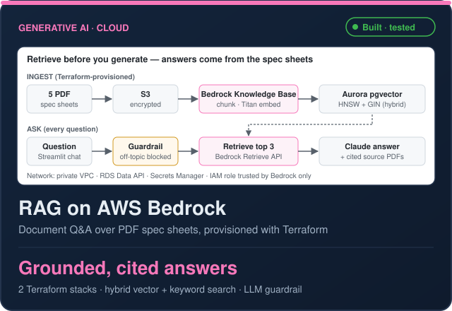
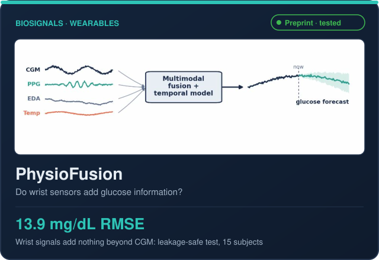
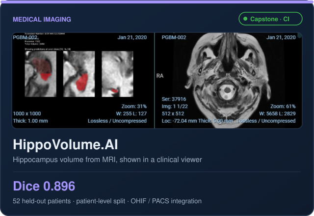
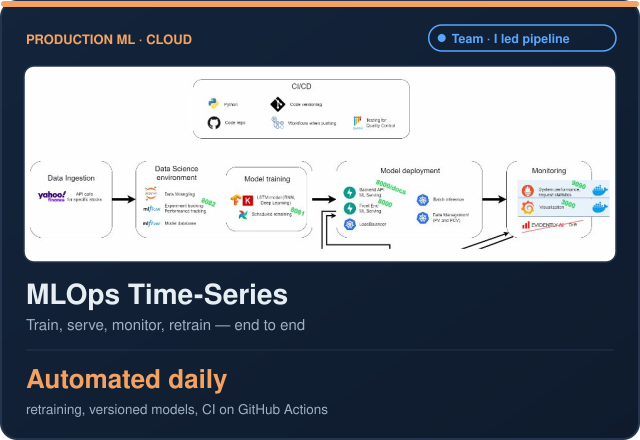
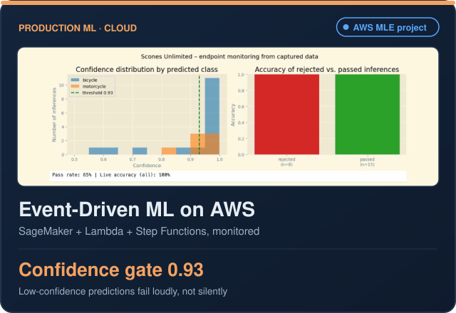
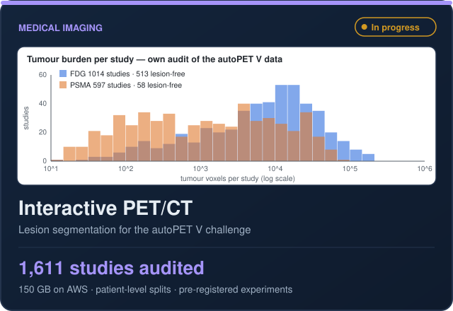

# Mir Mehdi Seyedebrahimi, Dr.-Ing.

**ML engineer for biomedical signals and medical imaging — from raw sensor data to tested, deployed models.**

Berlin, Germany · open to senior ML roles and freelance projects

I spent 10 years building medical sensors and the ML behind them — at Huawei's sensor lab, Helmholtz Munich / TUM and medtech start-ups.
I care most about evaluation that survives contact with real patients: subject-level splits, leakage control, calibration under device shift.
Now I ship it: pipelines, experiment tracking, containers, CI and AWS.

### What I can do for you

| Service | What it covers |
|---|---|
| **Biosignal & wearable ML** | ECG/HRV, PPG, EDA, respiration, CGM — cleaning, fusion, forecasting |
| **Medical imaging** | Segmentation and measurement on MRI, PET/CT, ultrasound; DICOM workflows |
| **Validation audits** | Find data leakage and over-optimistic results before a regulator or customer does |
| **Production on AWS** | From notebook to pipeline: MLflow, Airflow, FastAPI, Docker, SageMaker, Lambda, CI, CD, Kubernetes, Terraform, Bedrock |

---

### Selected projects

<table>
<tr>
<td width="33%" valign="top"> <b><a href="https://github.com/mirmehdi/bedrock-rag-terraform">RAG on AWS Bedrock</a></b> — Document Q&amp;A over PDF spec sheets: Bedrock Knowledge Base on Aurora pgvector, all provisioned with Terraform; guarded chat with cited sources.</td>
<td width="33%" valign="top"> <b><a href="https://github.com/mirmehdi/physiofusion">PhysioFusion</a></b> — Leakage-controlled test of wearable sensor fusion for glucose forecasting. Python library + <a href="https://doi.org/10.64898/2026.08.03.26359550">medRxiv preprint</a>.</td>
<td width="33%" valign="top"> <b><a href="https://github.com/mirmehdi/hippocampus-volume-ai">HippoVolume.AI</a></b> — U-Net hippocampus segmentation and volume report from MRI, designed for a PACS workflow.</td>
</tr>
<tr>
<td width="33%" valign="top"> <b><a href="https://github.com/mirmehdi/stock_prediction_mlops-pipeline-timeseries">MLOps Time-Series Pipeline</a></b> — Airflow, MLflow, FastAPI and Docker with daily retraining. Team project; I led the pipeline.</td>
<td width="33%" valign="top"> <b><a href="https://github.com/mirmehdi/scones-unlimited-ml-awsworkflow">Event-Driven ML on AWS</a></b> — SageMaker endpoint orchestrated by Lambda and Step Functions, with data capture.</td>
<td width="33%" valign="top"> <b><a href="https://github.com/mirmehdi/petct-interactive">Interactive PET/CT</a></b> — autoPET V challenge: 150 GB on AWS, own data audit, pre-registered experiments. <i>In progress.</i></td>
</tr>
</table>

Status labels are honest: "in progress" means the work is ongoing, and results are shown only once measured.

**Also in progress:** [tus-rec](https://github.com/mirmehdi/tus-rec) — trackerless freehand ultrasound reconstruction (TUS-REC challenge).

---

### Industry R&D (code not public)

Non-invasive glucose and metabolite sensing (optical, photoacoustic, impedance) with ML-based calibration · 10+ sensors designed from concept to pre-product · a respiratory-monitoring device taken through clinical testing.

### Publications & IP

- **PNAS** (co-first author) — [Short-wavelength optoacoustic spectroscopy based on water muting](https://doi.org/10.1073/pnas.1910597117)
- **Patent** — [WO 2024/260547 A1](https://patents.google.com/patent/WO2024260547A1), multimodal metabolite-sensing apparatus (Huawei Technologies)
- **medRxiv 2026** — [A Leakage-Controlled Evaluation of Multimodal Sensor Fusion for Wrist-Worn Glucose Estimation](https://doi.org/10.64898/2026.08.03.26359550)
- **arXiv 2026** — [My Chemical Harness: Evolutionary Molecular Design over Synthetic Pathways with LLM Agents](https://arxiv.org/abs/2606.11256)

### Teaching

Lecturer in ML & Data Science, IU International University of Applied Sciences (2024–2026): 10+ graduate modules and supervision of M.Sc. theses.

### Supervised theses

<table> <tr> <th align="left">Thesis</th> <th align="left">Focus</th> <th align="left">Code</th> </tr> <tr> <td> <a href="https://github.com/mirmehdi/PolyFold_frontend_beta"><strong>LLM-Agent Molecular Design</strong></a>  <em>M.Sc. thesis (supervised)</em> </td> <td> Evolutionary molecular / polymer design with large-language-model agents; interactive web frontend. Associated ACS preprint (under review). </td> <td> <a href="https://github.com/mirmehdi/PolyFold_frontend_beta">PolyFold&nbsp;(frontend, beta)</a> </td> </tr> <tr> <td> <a href="https://github.com/Sara-Hosseini/financial-time-series-forecasting"><strong>Financial Time-Series Forecasting</strong></a>  <em>M.Sc. thesis (supervised)</em> </td> <td> Forecasting and evaluation on financial time-series data. </td> <td> <a href="https://github.com/Sara-Hosseini/financial-time-series-forecasting">financial-time-series-forecasting</a> </td> </tr> </table>

Additional supervised theses (knowledge distillation, parameter-efficient fine-tuning, time-series forecasting) — available on request.

---

### Tools

Python · PyTorch · scikit-learn · MLflow · Airflow · FastAPI · Docker · GitHub Actions · AWS (S3, EC2, SageMaker, Bedrock, Lambda, Step Functions, Aurora) · Terraform · SQL · MATLAB
